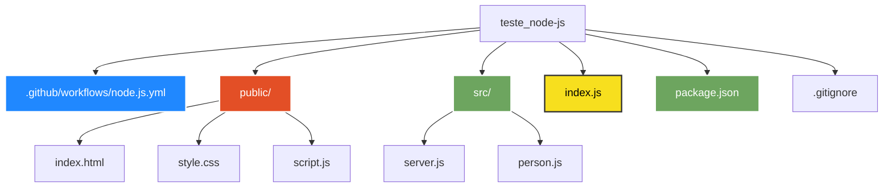

# Conversa com terminal 🚀🤖


[](https://github.com/AliceSilva2012/teste_node-js/actions/workflows/node.js.yml)

> Uma aplicação interativa em Node.js com Orientação a Objetos que evoluiu de uma ferramenta de linha de comando (CLI) na **v1** para uma **interface visual de terminal no navegador (v2)** servida com Express.js.

---

## 💻 Sobre o Projeto

O projeto **Conversa com terminal** (`teste_node-js`) foi desenvolvido para praticar conceitos essenciais de back-end e integração full-stack com Node.js. Na **v2.0.0**, a lógica original de coleta e validação de dados (nome e idade) com a classe `Person` foi conectada a uma janela de terminal interativa no navegador construída com HTML, CSS e JavaScript.

Além disso, o repositório mantém a versão original via terminal (`index.js`) e conta com pipeline de integração contínua via **GitHub Actions** (`node.js.yml`), validando o código automaticamente nas versões 18.x, 20.x e 22.x do Node.js a cada `push` ou `pull request`.

---

## ⚙️ Funcionalidades

- **Reinicialização da conversa:** permite iniciar novamente o fluxo de interação sem precisar atualizar a página.
- **Servidor Express.js:** Entrega os arquivos estáticos da pasta `public/` e expõe rotas (`POST /api/nome` e `POST /api/idade`) que processam as entradas no back-end.
- **Orientação a Objetos (POO):** Classe `Person` modularizada em `src/person.js`, responsável por instanciar o usuário e executar o método `sayName()`.
- **Validação e Sanitização de Inputs:** Remoção de espaços extras com `.trim()` e extração exclusiva de dígitos numéricos na idade com Regex (`replace(/\D/g, '')`).
- **Compatibilidade CLI (v1):** Mantém o modo clássico via linha de comando utilizando o módulo nativo `node:readline`.
- **Integração Contínua (CI):** Verificação automatizada de build e execução via GitHub Actions.

---

## 🏗️ Arquitetura

O projeto utiliza uma arquitetura dividida em duas camadas principais:

- **Front-end (`public/`):** responsável pela interface visual, interação com o usuário e comunicação com a API utilizando Fetch API.
- **Back-end (`src/`):** responsável pelo processamento das requisições HTTP, validação dos dados e gerenciamento da lógica de negócio por meio da classe Person.

---

## 📊 Estrutura de Fluxo do Sistema 

Abaixo está o caminho dos dados entre o navegador (`public/`) e o servidor Node.js (`src/`) durante a execução:

| Etapa | Origem / Arquivo | Ação / Exemplo de Retorno |
| :--- | :--- | :--- |
| **1. Entrada do Nome** | `public/index.html` + `script.js` | Envia o nome digitado via `POST /api/nome` |
| **2. Instanciação** | `src/server.js` + `src/person.js` | `const pessoa = new Person(respostaNome.trim());` |
| **3. Saudação** | `Person.sayName()` | `"Olá, Alice!"` e pergunta `"Qual é a sua idade?"` |
| **4. Entrada da Idade** | `public/script.js` | Envia a idade digitada via `POST /api/idade` |
| **5. Validação Numérica** | `src/server.js` | Extrai os números com `replace(/\D/g, '')` |
| **6. Mensagem Final** | Tela do Terminal | `"Bem-vindo(a) ao nosso sistema operacional, Alice!"` |

---

## 🛠️ Tecnologias Utilizadas

- **Node.js & Express.js:** Servidor HTTP, gerenciamento de rotas (`POST`), middlewares (`express.json` e `express.static`) e módulos CommonJS.
- **JavaScript (ES6+):**
  - Programação Orientada a Objetos (`class Person`).
  - Requisições assíncronas no front-end (`fetch` com `async/await`).
  - Manipulação do DOM (`createElement`, `appendChild`, eventos `keydown`).
  - Expressões Regulares (Regex) e manipulação de strings.
- **HTML5 & CSS3:** Estruturação semântica e layout de terminal estilizado com Flexbox.
- **GitHub Actions:** Pipeline de CI para validação automatizada do projeto.
- **Git & GitHub:** Controle de versão com branches (`main`, `v2`) e releases semânticas (`v1.0.0`, `v2.0.0`).

---

## 🚀 Como Executar o Projeto Localmente

### Pré-requisitos
- [Node.js](https://nodejs.org/) instalado (versão 18.x ou superior recomendada).
- [Git](https://git-scm.com) instalado na máquina.

### ☕ Passo a Passo

1. **Clone este repositório:**
   ```bash
   git clone https://github.com/AliceSilva2012/teste_node-js.git
   ```

2. **Acesse a pasta do projeto:**
   ```bash
   cd teste_node-js
   ```

3. **Instale as dependências (Express):**
   ```bash
   npm install
   ```

4. **Execute a versão Web (v2):**
   ```bash
   node src/server.js
   ```

5. **Acesse no navegador:**
   ```bash
   http://localhost:3000 
   ```
   **Opcional: Para executar a versão CLI (v1):**
   ```bash
   node index.js
   ```

## 📁 Estrutura de Pastas


